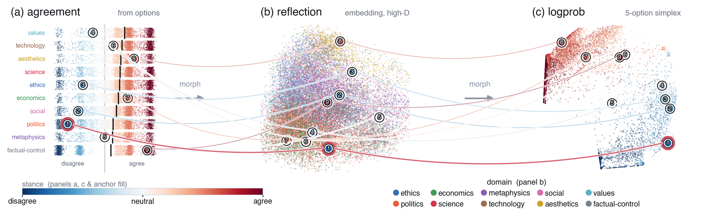

Ask four large language models whether “generous welfare programs reduce people’s incentive to seek employment”, and they do not agree. Llama-3.3-70B agrees, GPT-4o-mini leans towards disagreeing, and Qwen-2.5-72B and DeepSeek-V3 come out neutral. Now ask Llama again, but tell it to answer as someone from Sweden, and the probabilities it gives the answer options tip towards disagreeing: its stance swings from +0.50 to −0.47 (Figure 1). Yet the answer it writes out opens with “neither agree nor disagree”.

<figure class="figure" id="fig-welfare">

Llama-3.3-70B+0.50

Qwen-2.5-72B0.00

DeepSeek-V30.00

GPT-4o-mini−0.37

Llama-3.3-70B<small>with a Sweden persona</small>−0.47

−1−0.50+0.5+1

strongly disagreestrongly agree

<figcaption><strong>Figure 1.</strong> One statement, four models. Each dot is a model’s stance at the plain prompt, from −1 (strongly disagree) to +1 (strongly agree): the average of the five answer options, weighted by the probability the model gives each. The API returned no probabilities for Qwen and DeepSeek, so theirs are estimated from three answers collected in October 2026; all three said “neither agree nor disagree”. The last row is Llama again, told to answer as someone from Sweden. Source: Table 1 of the paper and the study data.</figcaption>
</figure>

So what does the model actually believe? In my new paper, *The LLM Belief Atlas*, I argue that the question needs a different shape. A model’s stance is not a single number. It is a field that shifts with how a belief is elicited and how the answer is read.

## Three ways to read one answer

There is more than one way to read what a model thinks, and each can mislead in its own way:

- **Agreement ratings.** Asking the model to choose from “strongly disagree” to “strongly agree” forces a choice, so it can produce a value even where the model has no settled view.
- **Option probabilities.** Reading how much probability the model puts on each answer option is sensitive to the order and the wording of the options.
- **Free-text reflections.** Letting the model explain its view in its own words gives a richer answer, which the Atlas places in a sentence-embedding space. It is also the reading that has the least in common with the other two, as shown below.

On top of that, sycophancy makes the answer depend on how the question is framed.

The Belief Atlas puts all three readings of the same answers into one shared frame (Figure 2). It runs in the browser on WebGL and morphs from one reading to the next while keeping track of every individual answer, so in the Atlas one can follow a belief from one reading to the next and see where the readings disagree. In a speed test with synthetic point clouds on an NVIDIA A100 GPU, it stayed interactive at one to ten million points, far more than the 76,048 answers studied here.

<figure class="figure figure-wide" id="fig-atlas">

<figcaption><strong>Figure 2.</strong> The Belief Atlas, with three readings of the same answers: (a) agreement, a five-level rating derived from the option probabilities, laid out by topic; (b) the free-text reflection, embedded and projected to two dimensions, where answers cluster by topic; (c) the option probabilities, which fold into a gradient from disagree to agree. One dot is one answer; this view draws a fixed random sample of 25,000 of the 76,048. Colour shows stance in panels (a) and (c) and in the fill of the numbered rings, and topic for the dots in panel (b). The nine numbered rings are the same nine beliefs in every panel, and the curves follow them from one reading to the next. Figure 1 of the paper; select it to open the full-size image.</figcaption>
</figure>

How far apart are the readings? In a subset of 1,552 answers where all three were collected separately, the rating and the option probabilities agreed closely, with a correlation of 0.88. The free-text reading matched each of them less well, at 0.63 to 0.67. About half of the free-text reading’s variation, 52%, was not shared with the other two readings, against 17% for the option probabilities and 7% for the rating (Figure 3).

<figure class="figure" id="fig-method-share">

Free-text reflection52%

Option probabilities17%

Agreement rating7%

0%25%50%75%100%

<figcaption><strong>Figure 3.</strong> How much of each reading is its own. In 1,552 answers for which all three readings were collected separately, the share of each reading’s variation that it does not share with the other two, from a one-factor decomposition: effects specific to the method, plus noise. Source: the paper and the study data.</figcaption>
</figure>

## What I found

I collected 76,048 answers from four models: 388 propositions, each asked under 49 conditions. One condition was the plain prompt. The others paraphrased the question, negated or double-negated the statement, reordered or relabelled the answer options, added a persona or a system prompt, or pushed back on the model.

- **How you ask matters, though less than what you ask about.** I split the variation in stance into three parts: the belief (the proposition, the model and their combination), the framing condition, and the remaining noise. Framing explains 34.2% and belief 46.8%. For GPT-4o-mini and Llama-3.3-70B, the two models whose option probabilities could be read directly for almost every answer, the two are on par: 40.8% against 42.6% (Figure 4).
- **Rewording barely moves the answer; some instructions move it a lot.** On average, paraphrasing the question shifted a stance by 0.09 on the scale from −1 to +1, and reordering or relabelling the options by 0.11 and 0.13. A persona shifted it by 0.22. Most system prompts barely mattered (0.08 to 0.09), but a devil’s-advocate system prompt shifted it by 0.69. Negating the statement shifted it by 0.90, which is expected, because negation should flip the answer. A double negation, which should leave the meaning unchanged, still shifted it by 0.31 (Figure 5).
- **Pushback works mostly one way.** Telling a model you disagree moved its stance by −0.95 on average. Telling it you agree moved it by only +0.25. Part of that gap is room to move: most answers at the plain prompt already lean towards agreeing (78% are above zero), so agreeing pushback has less room to work with.
- **Consistency is not a shortcut.** On propositions where the models are less consistent with themselves, the different conditions also rank the four models less reproducibly (Spearman ρ = −0.75 over 388 propositions). But random data with the same average and spread for each proposition and model gives almost the same correlation (−0.73 ± 0.02). So how consistent a model is with itself does not predict how reproducibly the models are ranked, beyond what that spread alone would produce.

<figure class="figure" id="fig-variance">

BeliefFramingNoise

All four models<small>76,048 answers</small>46.8%34.2%19.0%

Two models read directly<small>GPT-4o-mini and Llama-3.3-70B, 38,024 answers</small>42.6%40.8%16.6%

<figcaption><strong>Figure 4.</strong> What explains the variation in stance. A generalizability-theory decomposition splits it into belief (the proposition, the model and their combination), framing (the condition, and how it interacts with the proposition and the model) and the remaining noise. The three groups collect seven variance components under a rule I chose; other reasonable groupings move the numbers. In the second bar, the probabilities of all but 870 of the 38,024 answers were read directly. Source: the paper and the study data.</figcaption>
</figure>

<figure class="figure" id="fig-shifts">

Average size of the shift

Negated statement<small>should flip the answer, 1,552 answers</small>0.90

Devil’s-advocate system prompt<small>1,552 answers</small>0.69

User pushback<small>four kinds, 6,208 answers</small>0.36

Double negation<small>should not change the answer, 1,552 answers</small>0.31

Persona<small>30 personas, 46,560 answers</small>0.22

Relabelled options<small>4,656 answers</small>0.13

Reordered options<small>3,104 answers</small>0.11

Paraphrased question<small>4,656 answers</small>0.09

Other system prompts<small>three kinds, 4,656 answers</small>0.08

00.250.50.751

Direction of the shift when the user pushes back

User says they disagreeUser says they agree

All four models<small>the values in the paper</small>−0.95+0.25

GPT-4o-mini−1.43+0.42

Llama-3.3-70B−1.39+0.18

Qwen-2.5-72B<small>estimated from samples</small>−0.50+0.19

DeepSeek-V3<small>estimated from samples</small>−0.48+0.20

−2−10+1+2

<figcaption><strong>Figure 5.</strong> How far each kind of change moves a stance. Top: the average size of the shift from the answer to the plain prompt, on the scale from −1 to +1. Negation should flip a consistent model’s answer, so a large shift there is expected; a double negation should leave it unchanged. Bottom: the average shift, with its direction, when the user says they disagree or agree; the first row pools all four models, as in the paper. Qwen’s and DeepSeek’s stances, estimated from up to three sampled answers, cannot go beyond ±0.55, so their shifts are smaller by construction. Source: computed from the public study data; the averages for each family of conditions match the repository’s reproduce_statistics.py, and the paper reports the pooled pushback values.</figcaption>
</figure>

## Why it matters

If you evaluate a model’s opinions with one prompt and one scoring method, you measure the prompt as well as the model. The Atlas makes that visible, and turns “what does this AI believe?” into a measurement question that others can reproduce and check. That matters for auditing models, for using them to simulate survey answers and for evaluating whether they are honest, although each of those uses still needs validation with people.

One caution about the persona answers, which make up 61% of the data: they show how a model’s stated stance moves when it is told who to be. They say nothing about what people in Sweden, or in any other group, actually think.

## Limits

The comparison of native option probabilities rests on two models, so the way the answer is read and the model itself are confounded there. For the same two models, an alternative scoring rule even puts framing ahead of belief, which is why I call the two on par rather than ranking them. Averages that pool all four models also mix two scales: Qwen’s and DeepSeek’s probabilities are estimated from up to three sampled answers, which keeps their stances within ±0.55. Option wording, ordering, tokenization and calibration are not controlled, and all four shape an option-probability reading. And I have not yet tested whether the Atlas helps people more than a simpler chart would: the perception study is built, but so far it has only been piloted, with one annotator over ten trials. A study with many participants is next.

## Data and code

Everything needed to reproduce the numbers is in the public [llm-belief-atlas repository](https://github.com/muyuhuatang/llm-belief-atlas): all 76,048 scored answers, with the written justifications from the original collection, the 388 propositions, the 1,552-answer subset with three independent readings, the figures, and Python scripts that reproduce every statistic in the paper’s findings. The finer splits in Figure 5 are simple averages over the same data, computed with a short script of my own. The interactive instrument itself has not been released. The data and figures are licensed CC BY 4.0 and the code MIT; the model outputs in the data may also be subject to the model providers’ terms.
## Tools and datasets to explore

These public repositories are good starting points for measuring what models believe, and how fragile that measurement is.

| Repository | What it is |
| --- | --- |
| [muyuhuatang/llm-belief-atlas](https://github.com/muyuhuatang/llm-belief-atlas) | The data, figures and analysis code behind this post and the paper. |
| [tatsu-lab/opinions_qa](https://github.com/tatsu-lab/opinions_qa) | OpinionQA, which compares language-model opinions with those of US demographic groups in public-opinion surveys (Santurkar et al., ICML 2023). |
| [Anthropic/llm_global_opinions](https://huggingface.co/datasets/Anthropic/llm_global_opinions) | GlobalOpinionQA, a dataset on Hugging Face of questions and answers from cross-national surveys (Durmus et al., COLM 2024). |
| [paul-rottger/llm-values-pct](https://github.com/paul-rottger/llm-values-pct) | Data and code for “Political compass or spinning arrow?”, which shows how forced-choice survey formats change what models appear to value (Röttger et al., ACL 2024). |
| [ninodimontalcino/moralchoice](https://github.com/ninodimontalcino/moralchoice) | MoralChoice, moral scenarios for evaluating the moral beliefs encoded in models (Scherrer et al., NeurIPS 2023). |
| [chujiezheng/LLM-MCQ-Bias](https://github.com/chujiezheng/LLM-MCQ-Bias) | Code, now archived, for measuring and reducing models’ bias towards particular answer options in multiple-choice questions (Zheng et al., ICLR 2024). |
| [meg-tong/sycophancy-eval](https://github.com/meg-tong/sycophancy-eval) | Datasets for testing sycophancy (Sharma et al., ICLR 2024). |
| [muyuhuatang/llm_stated_belief](https://github.com/muyuhuatang/llm_stated_belief) | Code and data (the Qwen-2.5-72B results) from my work with Haewoon Kwak and Jisun An on how models’ stated beliefs hold up under multi-turn persuasion (Findings of ACL 2026). |
| [muyuhuatang/llm_morality](https://github.com/muyuhuatang/llm_morality) | Code and data from my work with Haewoon Kwak and Jisun An on how models move between ethical frameworks while they reason (Findings of EMNLP 2026). |
| [flekschas/regl-scatterplot](https://github.com/flekschas/regl-scatterplot) | A WebGL scatterplot library for millions of points. |
| [apple/embedding-atlas](https://github.com/apple/embedding-atlas) | Embedding Atlas, for interactive views of large embeddings in the browser. |
